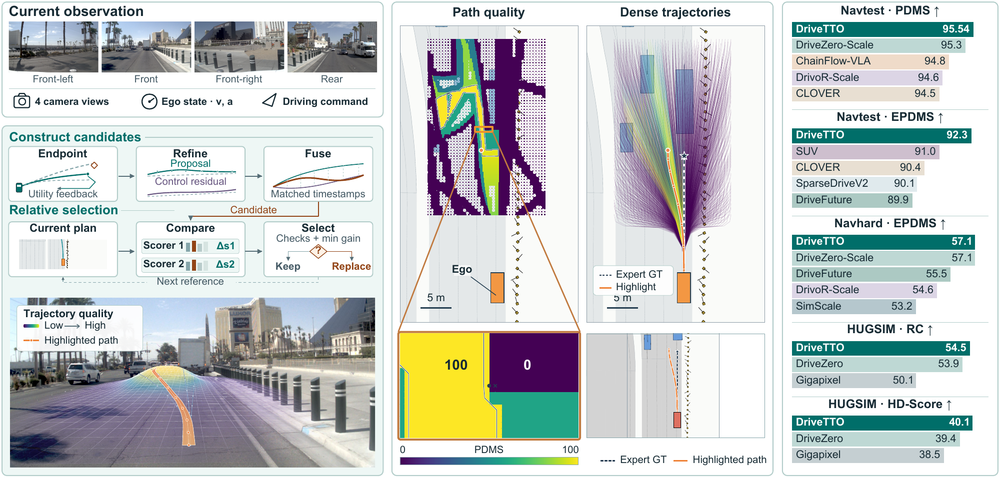
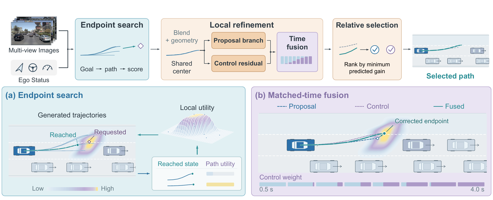
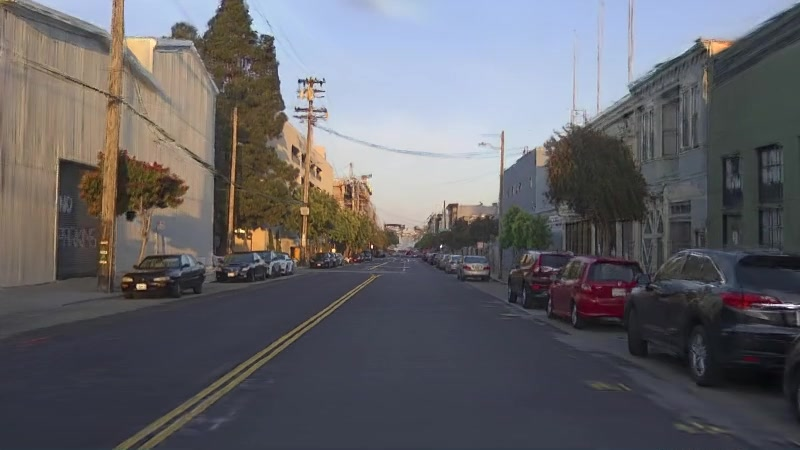
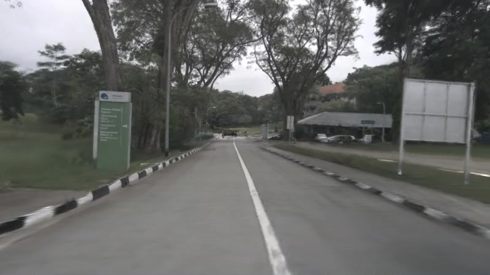
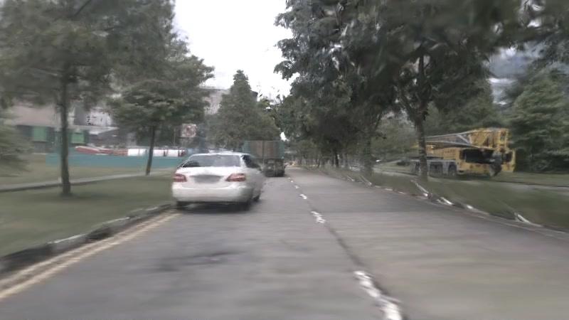
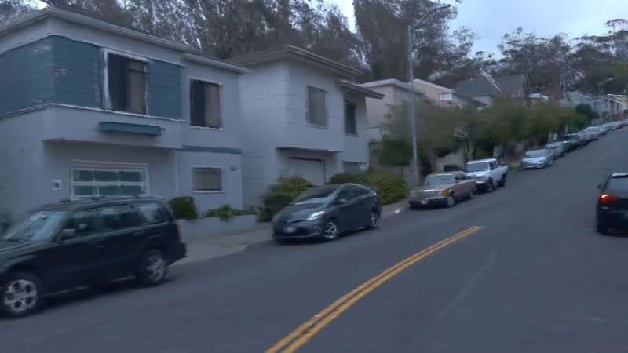
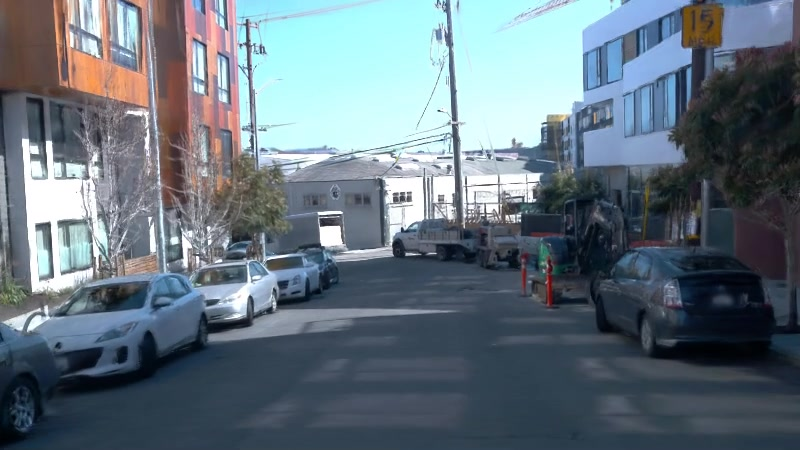
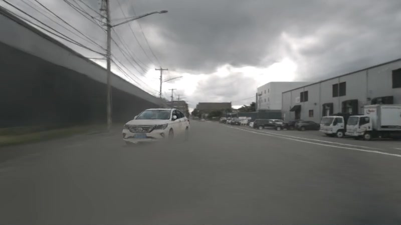
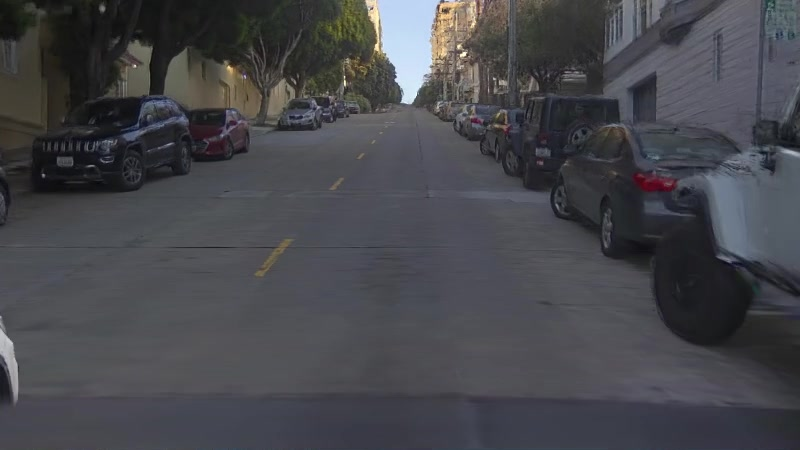
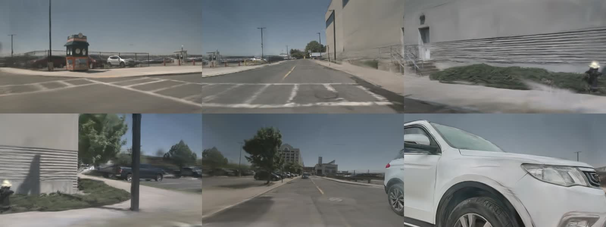

<h1 align="center">DriveTTO: Understanding Search and Selection<br>in Test-Time Trajectory Optimization for End-to-End Driving</h1>

<p align="center">
  <a href="https://arxiv.org/abs/2611.29205"></a>
  <a href="https://rtwotwo.github.io/DriveTTO/"></a>
  <a href="https://github.com/Rtwotwo/DriveTTO"></a>
  <a href="https://rtwotwo.github.io/DriveTTO/#videos"></a>
  <a href="LICENSE"></a>
</p>

<p align="center"><span>Xinyao Rao<sup>1</sup></span> &nbsp; <span>Zecheng Tang<sup>2</sup></span> &nbsp; <span>Zheyuan Lai<sup>3</sup></span> &nbsp; <span>Liuxuan Sun<sup>1</sup></span> &nbsp; <span>Minjun Yu<sup>3</sup></span> &nbsp; <span>Xun Cao<sup>1</sup></span> &nbsp; <span>Wei Li<sup>1,3,*</sup></span></p>
<p align="center"><span><sup>1</sup>Nanjing University</span> &nbsp; <span><sup>2</sup>Peking University</span> &nbsp; <span><sup>3</sup>EABOT.AI</span><br><sub><sup>*</sup>Corresponding author &nbsp; · &nbsp; <a href="mailto:yoloredal@gmail.com">yoloredal@gmail.com</a></sub></p>

DriveTTO improves driving trajectories at inference time with the planning models held fixed. It searches near native proposals and uses frozen scorers to decide whether a refinement should replace the current plan.

## News

- **2026.11.24** — The [DriveTTO paper](https://arxiv.org/abs/2611.29205) is available on arXiv. Read the [PDF](https://arxiv.org/pdf/2611.29205) or copy the [BibTeX citation](#citation).
- **2026.10.22** — The [project page](https://rtwotwo.github.io/DriveTTO/) and [driving demonstrations](https://rtwotwo.github.io/DriveTTO/#videos) are available.

## DriveTTO at a glance

<p align="center"><a href="https://arxiv.org/pdf/2611.29205"></a></p>

In the Navtrain example above, endpoint requests just 5 cm apart yield trajectories with offline PDMS of 100 and 0. On Navtest, DriveTTO recovers **51.35%** of native zero-score cases on average. Accounting for new failures, the zero-score rate falls from **1.63% to 1.13%**.

| Benchmark | Result | Evaluation setting |
| --- | --- | --- |
| Navtest | 95.54 PDMS / 92.30 EPDMS | NAVSIM v1 / v2 |
| Navhard | 57.10 EPDMS | Two-stage evaluation |
| HUGSIM | 54.5 route completion / 40.1 HD-Score | 345 scenarios, observed commands |

Each benchmark uses its reported configuration. DriveTTO-S, the single-scorer variant, improves all six evaluated native planners on both Navtest and Navhard. [Explore the results and evaluation settings.](https://rtwotwo.github.io/DriveTTO/#results)

## Method

<p align="center"><a href="docs/assets/images/paper-overview.png"></a></p>

A frozen scorer evaluates completed paths and guides resampling around the endpoints they reach. From a shared reference, one branch refines planner proposals while the other perturbs vehicle controls. DriveTTO blends poses at matching times and accepts a branch or fused plan when both scorers predict an improvement over the retained plan. [Watch the method animation.](https://rtwotwo.github.io/DriveTTO/player.html?v=algorithm)

## Driving demonstrations

[Watch the 6 min 36 s introduction](https://rtwotwo.github.io/DriveTTO/#introduction) or [browse the gallery](https://rtwotwo.github.io/DriveTTO/#videos).

### HUGSIM closed-loop rollouts

<table align="center">
<tbody>
<tr>
<td align="center" width="33%"><a href="https://rtwotwo.github.io/DriveTTO/player.html?v=hugsim-pandaset-053-easy_00-recut"></a><p align="left"><em>PandaSet · easy · 9.5 s · RC 100.0 · HD 100.0</em></p></td>
<td align="center" width="33%"><a href="https://rtwotwo.github.io/DriveTTO/player.html?v=hugsim-nuscenes-scene-0013-easy_00-recut"></a><p align="left"><em>nuScenes · easy · 12 s · RC 100.0 · HD 99.4</em></p></td>
<td align="center" width="33%"><a href="https://rtwotwo.github.io/DriveTTO/player.html?v=hugsim-waymo-113792265837_0_200-hard_00-recut"></a><p align="left"><em>Waymo · hard · 16.5 s · RC 100.0 · HD 94.2</em></p></td>
</tr>
<tr>
<td align="center" width="33%"><a href="https://rtwotwo.github.io/DriveTTO/player.html?v=hugsim-nuscenes-scene-0010-hard_00-piano"></a><p align="left"><em>nuScenes · hard · 17.5 s · RC 100.0 · HD 97.1</em></p></td>
<td align="center" width="33%"><a href="https://rtwotwo.github.io/DriveTTO/player.html?v=hugsim-waymo-163453191685_0_200-hard_00-piano"></a><p align="left"><em>Waymo · hard · 29 s · RC 100.0 · HD 96.7</em></p></td>
<td align="center" width="33%"><a href="https://rtwotwo.github.io/DriveTTO/player.html?v=hugsim-waymo-166085257829_0_200-hard_00-piano"></a><p align="left"><em>Waymo · hard · 33.25 s · RC 100.0 · HD 97.2</em></p></td>
</tr>
<tr>
<td align="center" width="33%"><a href="https://rtwotwo.github.io/DriveTTO/player.html?v=hugsim-nuscenes-scene-0528-hard_01-recut"></a><p align="left"><em>nuScenes · hard · 8.25 s · RC 100.0 · HD 100.0</em></p></td>
<td align="center" width="33%"><a href="https://rtwotwo.github.io/DriveTTO/player.html?v=hugsim-nuscenes-scene-0166-hard_00-piano"></a><p align="left"><em>nuScenes · hard · 15.5 s · RC 100.0 · HD 100.0</em></p></td>
<td align="center" width="33%"><a href="https://rtwotwo.github.io/DriveTTO/player.html?v=hugsim-nuscenes-scene-0071-hard_00-piano"></a><p align="left"><em>nuScenes · hard · 23 s · RC 100.0 · HD 99.4</em></p></td>
</tr>
<tr>
<td align="center" width="33%"><a href="https://rtwotwo.github.io/DriveTTO/player.html?v=hugsim-pandaset-039-extreme_01-recut"></a><p align="left"><em>PandaSet · extreme · 8.5 s · RC 100.0 · HD 99.2</em></p></td>
<td align="center" width="33%"><a href="https://rtwotwo.github.io/DriveTTO/player.html?v=nuscenes-scene-0167-extreme_01"></a><p align="left"><em>nuScenes · extreme · 19.75 s · RC 100.0 · HD 98.0</em></p></td>
<td align="center" width="33%"><a href="https://rtwotwo.github.io/DriveTTO/player.html?v=waymo-322492347634_0_200-extreme_01"></a><p align="left"><em>Waymo · extreme · 17.75 s · RC 100.0 · HD 95.4</em></p></td>
</tr>
</tbody>
</table>

### NAVSIM planning animations

<table align="center">
<tbody>
<tr>
<td align="center"><a href="https://rtwotwo.github.io/DriveTTO/player.html?v=00c489998dd4555c"></a><br><strong>Urban bend</strong><br><em>PDMS 100 · 4 s prediction horizon</em></td>
<td align="center"><a href="https://rtwotwo.github.io/DriveTTO/player.html?v=0114734fd69b598e"></a><br><strong>Narrow street</strong><br><em>PDMS 100 · 4 s prediction horizon</em></td>
</tr>
<tr>
<td align="center"><a href="https://rtwotwo.github.io/DriveTTO/player.html?v=013ec5b715635a66"></a><br><strong>Junction</strong><br><em>PDMS 100 · 4 s prediction horizon</em></td>
<td align="center"><a href="https://rtwotwo.github.io/DriveTTO/player.html?v=003ead1914c051d7"></a><br><strong>Bridge curve</strong><br><em>PDMS 100 · 4 s prediction horizon</em></td>
</tr>
</tbody>
</table>

## Citation

```bibtex
@misc{rao2026drivetto,
  title={DriveTTO: Understanding Search and Selection in Test-Time Trajectory Optimization for End-to-End Driving},
  author={Xinyao Rao and Zecheng Tang and Zheyuan Lai and Liuxuan Sun and Minjun Yu and Xun Cao and Wei Li},
  year={2026},
  eprint={2611.29205},
  archivePrefix={arXiv},
  url={https://arxiv.org/abs/2611.29205}
}
```

## Acknowledgements

We thank the authors of [ToAD](https://github.com/valeoai/TOAD) for demonstrating that DrivoR's scorer can be used as a reward to search for better trajectories at test time, [DrivoR](https://github.com/valeoai/DrivoR) for the end-to-end driving model by driving on registers, our own [ChainFlow](https://github.com/Rtwotwo/ChainFlow) planning and evaluation pipeline built on NAVSIM, and the [GETok-DSR-NAVSIM-v1](https://huggingface.co/minfishmovemountain/GETok-DSR-NAVSIM-v1) driving model weights and resources, all of which supported this project.
