<h1 align="center">🚗 DriveTTO: Understanding Search and Selection in Test-Time Trajectory Optimization</h1>

  
  
  

## 📰 News

- [ ] **2026.10.22** — Project page and visualization videos released.
- [ ] **2026.09.25** — DriveTTO reaches state-of-the-art PDMS/EPDMS on the NAVTEST benchmark.

## 🔍 Overview

**DriveTTO is a training-free framework for test-time trajectory optimization that connects structured search with reference-relative selection.** A driving planner may generate a good trajectory yet fail to select it. Adding more candidates therefore makes both trajectory quality and selection quality central to the value of search. DriveTTO explores alternatives around a retained complete plan and compares each proposed update with that reference, while keeping the driving models frozen throughout inference. Across the corresponding benchmark settings, DriveTTO achieves **95.5 PDMS** and **92.3 EPDMS** on NAVTEST, **57.1 EPDMS** on NAVHARD, and **54.5 route completion (RC)** with **40.1 HD-Score** on 345 HUGSIM scenarios. The single-scorer variant, **DriveTTO-S**, is also evaluated across six base planners against their native outputs and ToAD. [Full results](https://rtwotwo.github.io/DriveTTO/#results). The animation below illustrates how DriveTTO searches and selects around a retained complete plan at test time.

Concretely, endpoint feedback associates the predicted utility of a complete trajectory with its achieved terminal state, guiding further search through the planner's native path geometry. Geometric refinement, cross-model proposals and bounded control residuals produce alternative motions around the retained plan. Frozen scorers evaluate gains over the reference in a shared scoring context, and temporal fusion combines proposal and control trajectories along the prediction horizon. Each accepted update becomes the reference for later decisions. By separating the best trajectory available in a candidate pool from the trajectory actually returned, DriveTTO examines how candidate construction, filtering and ranking contribute to the final driving result.

## 🎬 Visualizations

  

<em>5 min 0 s · Relaxed piano · Method · Planning · Closed-loop driving — <a href="https://rtwotwo.github.io/DriveTTO/#videos">open the full gallery</a></em>

### 🛣️ HUGSIM closed-loop rollouts

<table align="center">
<tbody>
<tr>
<td align="center" width="33%"><a href="https://rtwotwo.github.io/DriveTTO/player.html?v=hugsim-pandaset-053-easy_00-recut">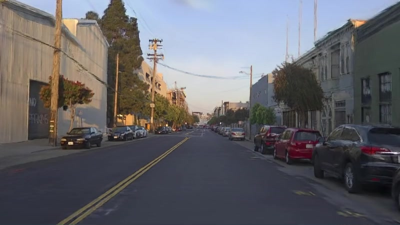</a>
<em>PandaSet · easy · 9.5 s · RC 100.0 · HD 100.0</em>
</td>
<td align="center" width="33%"><a href="https://rtwotwo.github.io/DriveTTO/player.html?v=hugsim-nuscenes-scene-0013-easy_00-recut">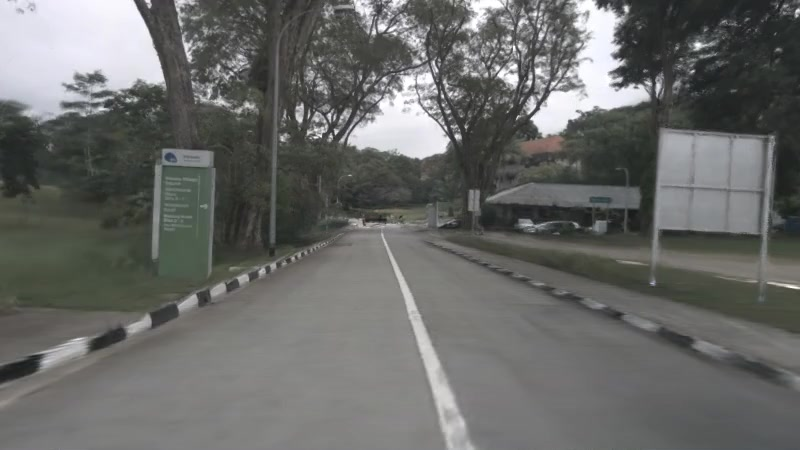</a>
<em>nuScenes · easy · 12 s · RC 100.0 · HD 99.4</em>
</td>
<td align="center" width="33%"><a href="https://rtwotwo.github.io/DriveTTO/player.html?v=hugsim-waymo-113792265837_0_200-hard_00-recut">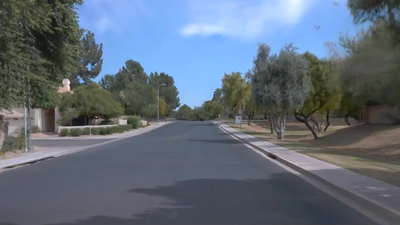</a>
<em>Waymo · hard · 16.5 s · RC 100.0 · HD 94.2</em>
</td>
</tr>
<tr>
<td align="center" width="33%"><a href="https://rtwotwo.github.io/DriveTTO/player.html?v=hugsim-nuscenes-scene-0010-hard_00-piano">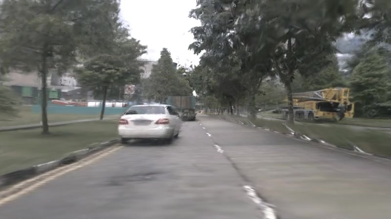</a>
<em>nuScenes · hard · 17.5 s · RC 100.0 · HD 97.1</em>
</td>
<td align="center" width="33%"><a href="https://rtwotwo.github.io/DriveTTO/player.html?v=hugsim-waymo-163453191685_0_200-hard_00-piano">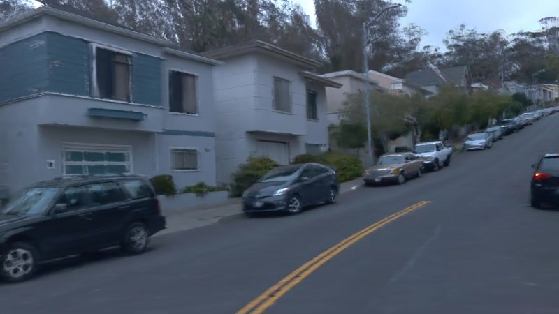</a>
<em>Waymo · hard · 29 s · RC 100.0 · HD 96.7</em>
</td>
<td align="center" width="33%"><a href="https://rtwotwo.github.io/DriveTTO/player.html?v=hugsim-waymo-166085257829_0_200-hard_00-piano">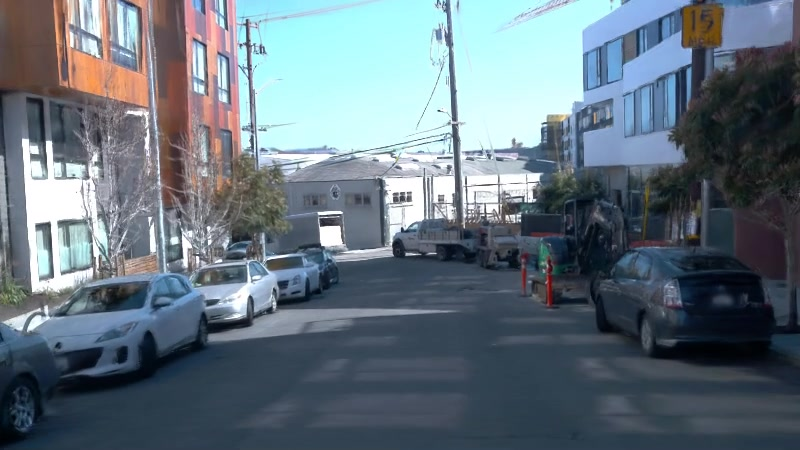</a>
<em>Waymo · hard · 33.25 s · RC 100.0 · HD 97.2</em>
</td>
</tr>
<tr>
<td align="center" width="33%"><a href="https://rtwotwo.github.io/DriveTTO/player.html?v=hugsim-nuscenes-scene-0528-hard_01-recut">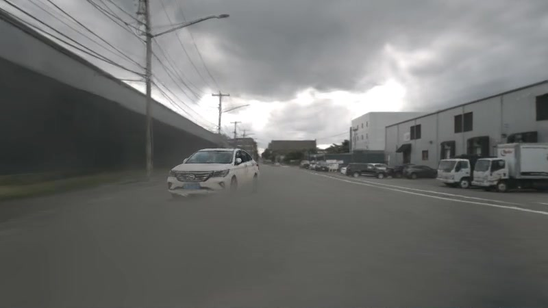</a>
<em>nuScenes · hard · 8.25 s · RC 100.0 · HD 100.0</em>
</td>
<td align="center" width="33%"><a href="https://rtwotwo.github.io/DriveTTO/player.html?v=hugsim-nuscenes-scene-0166-hard_00-piano">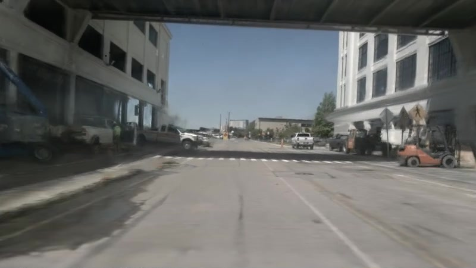</a>
<em>nuScenes · hard · 15.5 s · RC 100.0 · HD 100.0</em>
</td>
<td align="center" width="33%"><a href="https://rtwotwo.github.io/DriveTTO/player.html?v=hugsim-nuscenes-scene-0071-hard_00-piano">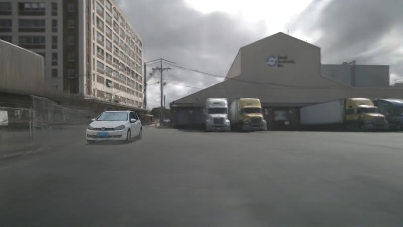</a>
<em>nuScenes · hard · 23 s · RC 100.0 · HD 99.4</em>
</td>
</tr>
<tr>
<td align="center" width="33%"><a href="https://rtwotwo.github.io/DriveTTO/player.html?v=hugsim-pandaset-039-extreme_01-recut">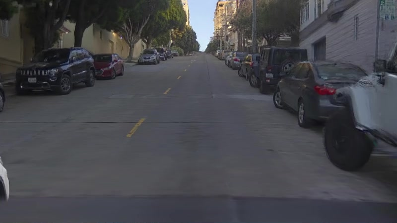</a>
<em>PandaSet · extreme · 8.5 s · RC 100.0 · HD 99.2</em>
</td>
<td align="center" width="33%"><a href="https://rtwotwo.github.io/DriveTTO/player.html?v=nuscenes-scene-0167-extreme_01">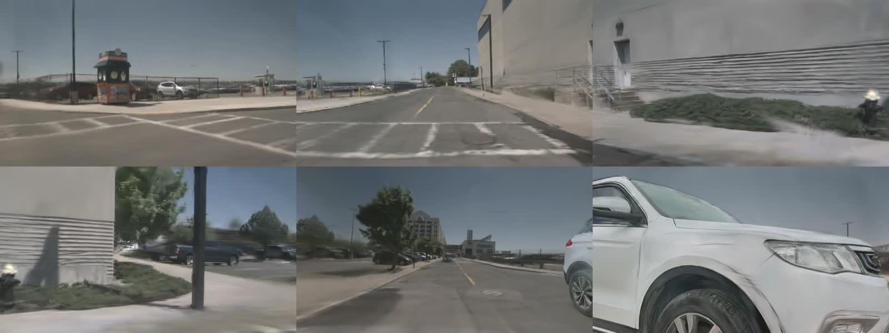</a>
<em>nuScenes · extreme · 19.75 s · RC 100.0 · HD 98.0</em>
</td>
<td align="center" width="33%"><a href="https://rtwotwo.github.io/DriveTTO/player.html?v=waymo-322492347634_0_200-extreme_01">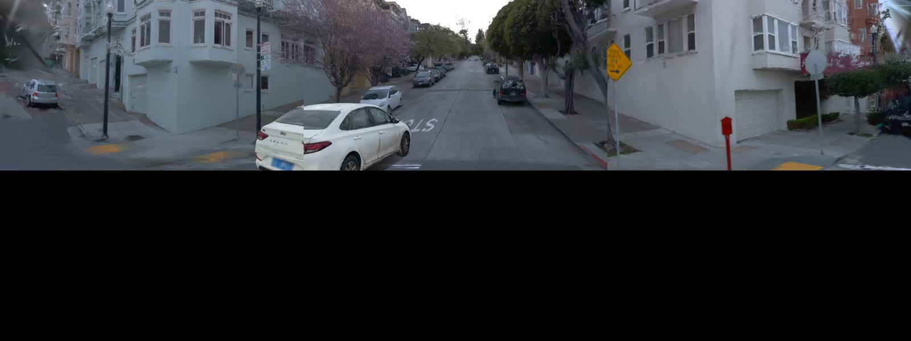</a>
<em>Waymo · extreme · 17.75 s · RC 100.0 · HD 95.4</em>
</td>
</tr>
</tbody>
</table>

### 🧭 NAVSIM planning animations

<table align="center">
<tbody>
<tr>
<td align="center"> <strong>Urban bend</strong> <em>PDMS 100 · 4 s prediction horizon</em></td>
<td align="center"> <strong>Narrow street</strong> <em>PDMS 100 · 4 s prediction horizon</em></td>
</tr>
<tr>
<td align="center"> <strong>Junction</strong> <em>PDMS 100 · 4 s prediction horizon</em></td>
<td align="center"> <strong>Bridge curve</strong> <em>PDMS 100 · 4 s prediction horizon</em></td>
</tr>
</tbody>
</table>

## 🙏 Acknowledgements

We thank the authors of [ToAD](https://github.com/valeoai/TOAD) for demonstrating that DrivoR's scorer can be used as a reward to search for better trajectories at test time, [DrivoR](https://github.com/valeoai/DrivoR) for the end-to-end driving model by driving on registers, our own [ChainFlow](https://github.com/Rtwotwo/ChainFlow) planning and evaluation pipeline built on NAVSIM, and the [GETok-DSR-NAVSIM-v1](https://huggingface.co/minfishmovemountain/GETok-DSR-NAVSIM-v1) driving model weights and resources, all of which supported this project.
