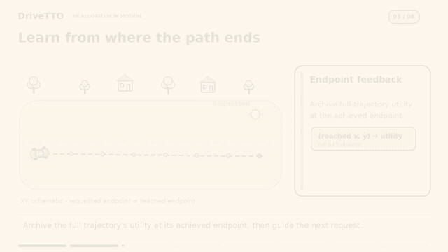
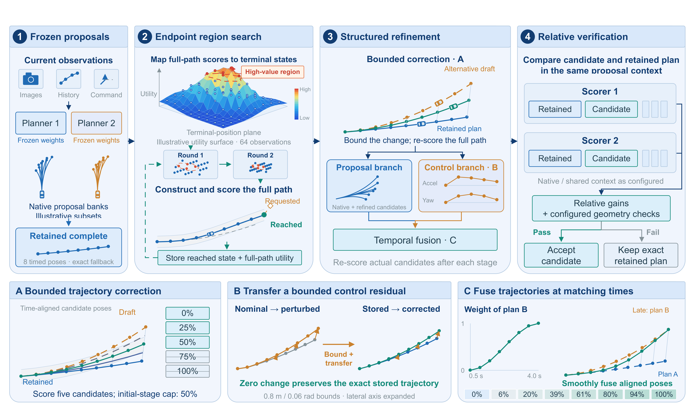

<h1 align="center">DriveTTO: Understanding Search and Selection in Test-Time Trajectory Optimization</h1>

  <a href="https://rtwotwo.github.io/DriveTTO/">Project page</a> ·
  <a href="https://rtwotwo.github.io/DriveTTO/#algorithm">Animated explanation</a> ·
  <a href="https://rtwotwo.github.io/DriveTTO/#introduction">Driving demonstrations</a> ·
  <a href="https://rtwotwo.github.io/DriveTTO/#results">Complete results</a>

**More search helps when its better candidates reach the returned plan.** DriveTTO constructs complete alternatives around a frozen planner's trajectory and studies how candidate construction, admission, ranking and replacement determine the final result. Model parameters stay fixed throughout inference.

## Watch the algorithm

**72 seconds · 2D animated explanation.** Follow a retained plan through endpoint feedback, bounded refinement, paired scoring and branch fusion. The animation illustrates the NAV1 Full schedule; paths and predicted gains are schematic. [Watch the complete animation](https://rtwotwo.github.io/DriveTTO/assets/videos/drivetto-algorithm-animation.mp4).

The [1:54 project introduction](https://rtwotwo.github.io/DriveTTO/#introduction) combines the animated method with recorded NAVSIM plan visualizations and selected HUGSIM hard/extreme driving scenes. Per-scene scores describe the complete source rollout; aggregate results are listed below.

## How DriveTTO works

1. **Keep a reference plan.** Each stage constructs alternatives around its entering reference and keeps that reference available. An accepted update becomes the reference for later comparisons; rejection returns the current reference exactly.
2. **Search endpoints using complete paths.** A native parent supplies intermediate geometry. After completing and scoring the path, store its utility at the achieved terminal state, including position, heading and speed. Nearby achieved states guide subsequent requests.
3. **Refine around a shared center.** Geometric search establishes a center for cross-model proposals and bounded control residuals. Residual transport adds the difference between two control rollouts to the stored trajectory; a zero perturbation preserves it.
4. **Measure relative gains.** Candidate and reference occupy fixed slots of the same scoring bank. In configured joint-scoring stages, frozen ChainFlow and DrivoR heads provide candidate-minus-reference gains and the minimum gain ranks admitted candidates. Initial interpolation and geometry use DrivoR. Each stage retains its specified admission and replacement rules.
5. **Fuse branches along the horizon.** Proposal and control trajectories are blended at corresponding future timestamps, using constant or smoothly varying weights. Score each complete fused path against the selected incumbent, and retain the incumbent if no replacement passes.

The paper separates **candidate opportunity** from **selection regret**. For a fixed candidate pool, the offline evaluator measures its best available candidate and the candidate actually returned. Their difference reveals how much opportunity selection loses. The accounting identity is **output gain = change in candidate opportunity − change in selection regret**. Inference uses learned scores; offline evaluator scores are used for analysis.

## Five benchmark metrics

| Benchmark | Metric | DriveTTO | Configuration |
|---|---|---:|---|
| NAVSIM-v1 NAVTEST | PDMS ↑ | **95.5** | NAV1 Full |
| NAVSIM-v2 NAVTEST | EPDMS ↑ | **92.3** | NAV2 geometric center + terminal-preserving tracking |
| NAVSIM-v2 NAVHARD | EPDMS ↑ | **57.1** | Control shooting + terminal-XY-constrained refinement |
| HUGSIM, 345 scenarios | Route completion ↑ | **54.5** | NAV1 weights, three weighted control rounds, observed commands |
| HUGSIM, 345 scenarios | HD-Score ↑ | **40.1** | Same HUGSIM configuration |

These are paper-reported results under the listed benchmark schedules. The [interactive tables](https://rtwotwo.github.io/DriveTTO/#results) include other methods, all 390 component values, NAVHARD S1/S2 breakdowns, and HUGSIM Easy/Medium/Hard/Extreme results. [Download the complete CSV](https://rtwotwo.github.io/DriveTTO/assets/data/results.csv).

## Transfer across six planners

DriveTTO-S is the single-scorer `endpoint_post` transfer branch. It uses the target planner's native anchor and top-64 bank with a frozen DrivoR scorer. Its configuration differs from NAV1 Full and the 57.1 NAVHARD schedule. ToAD uses K=10 on NAVTEST and K=5 on NAVHARD.

### NAVTEST PDMS

| Base planner | Native | ToAD | DriveTTO-S | Δ vs. ToAD |
|---|---:|---:|---:|---:|
| ZTRS | 87.1306 | 88.5780 | 91.0221 | +2.4441 |
| GTRS | 90.9300 | 92.1587 | 93.5195 | +1.3608 |
| Hydra-MDP | 90.8336 | 92.2803 | 93.4641 | +1.1838 |
| iPad | 91.7879 | 93.4141 | 94.2302 | +0.8161 |
| RAP-DINO | 93.8203 | 94.4600 | 94.5679 | +0.1079 |
| DrivoR | 94.5389 | 94.7202 | 94.8672 | +0.1470 |

### NAVHARD EPDMS

| Base planner | Native | ToAD | DriveTTO-S | Δ vs. ToAD |
|---|---:|---:|---:|---:|
| ZTRS | 46.1690 | 49.6922 | 51.4893 | +1.7971 |
| GTRS | 43.8706 | 49.3151 | 49.4346 | +0.1195 |
| Hydra-MDP | 41.1733 | 48.0827 | 47.6296 | -0.4531 |
| iPad | 36.8378 | 50.6090 | 47.8166 | -2.7924 |
| RAP-DINO | 38.6198 | 45.7217 | 52.5532 | +6.8315 |
| DrivoR | 54.5616 | 55.6365 | 56.2260 | +0.5895 |

DriveTTO-S improves on the native output for all six planners in these two tests. Its comparison with ToAD depends on the planner; the NAVHARD Hydra-MDP and iPad differences remain negative. Search latency and protocol details are provided on the project page.

## Controlled evidence

On 12,146 observed NAVTEST scenes with three search seeds and fixed model resources, Full averages **95.5116 PDMS**. It exceeds ordinary dual-scoring CEM8 by **0.4075 points** (95% CI [0.1149, 0.7274]; Holm-adjusted p=.036). Isolated p50 latency is **1.3093 s** for Full and **1.1998 s** for CEM8. These compare similar, rather than equal, execution costs.

The analyses also report scene-level degradation and stage-specific selection effects. The complete downstream comparison of minimum, mean and DrivoR terminal ranking does not resolve a mean-score difference. These measurements describe the evaluated NAVTEST data and model combination.

## Repository contents

- `docs/`: GitHub Pages website, benchmark tables, videos and media provenance.
- `assets/overview.png`: method overview.
- `.github/workflows/pages.yml`: static website deployment.
- `WEBSITE.md`: website deployment notes.

The paper and complete algorithm release links will be added here when available.
